# Hi, I'm Md. Akik Tanjil Jihan 🌍

**Geospatial data scientist & environmental researcher** — MSc candidate in Environmental Science and Disaster Management at Gopalganj Science and Technology University, Bangladesh.

I work at the intersection of **GIS, remote sensing, climate science and environmental policy**, with a focus on Bangladesh and South Asia. I combine field observations with satellite data and data-driven methods to support evidence-based decisions and environmental resilience.

---

## 🔭 What I work on

- 🛰️ **Remote sensing** — Landsat & Sentinel analysis, LULC change, land surface temperature, accuracy assessment
- 🌡️ **Climate modelling** — CMIP6 / NEX-GDDP projections, climate variability and extremes over South Asia
- 🤖 **Explainable ML for environment** — SHAP-driven models for LST and urban heat
- 🗺️ **Spatial analysis & cartography** — thematic maps and publication-quality geospatial datasets
- 🧭 **Field research** — surveys, KII, FGD, GPS-based field mapping

## 🧰 Tech stack

## 🗺️ Selected projects

<table>
<tr><td width="33%" valign="top"><a href="figures/fig01.jpg">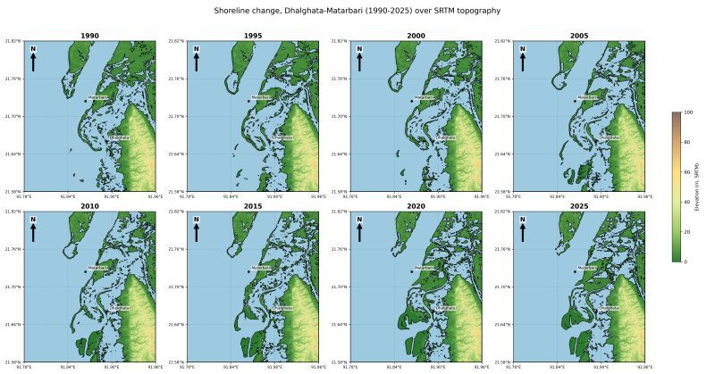</a> <b>Shoreline change of Dhalghata–Matarbari (1990–2025)</b></td><td width="33%" valign="top"><a href="figures/fig04.jpg">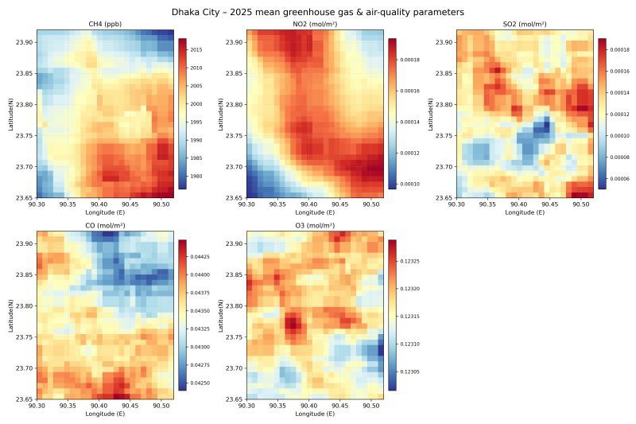</a> <b>Dhaka greenhouse gas and air-quality maps (2025)</b></td><td width="33%" valign="top"><a href="figures/fig13.jpg">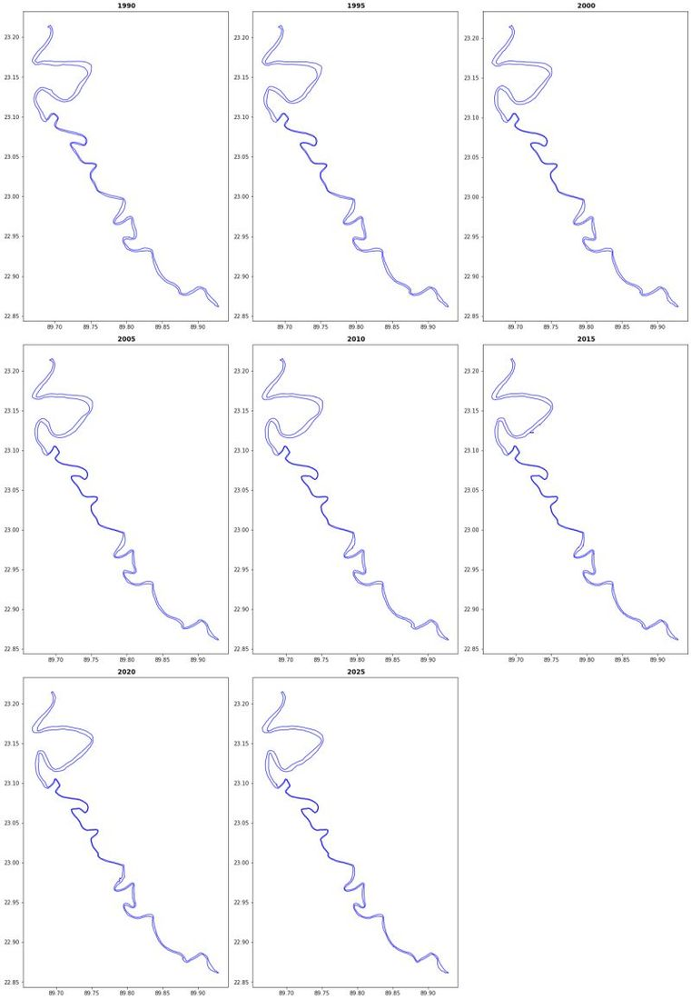</a> <b>River planform change (1990–2025)</b></td></tr>
<tr><td width="33%" valign="top"><a href="figures/fig05.jpg">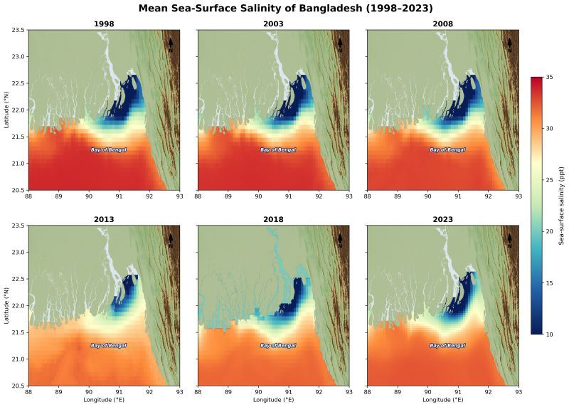</a> <b>Sea-surface salinity of Bangladesh (1998–2023)</b></td><td width="33%" valign="top"><a href="figures/fig06.jpg">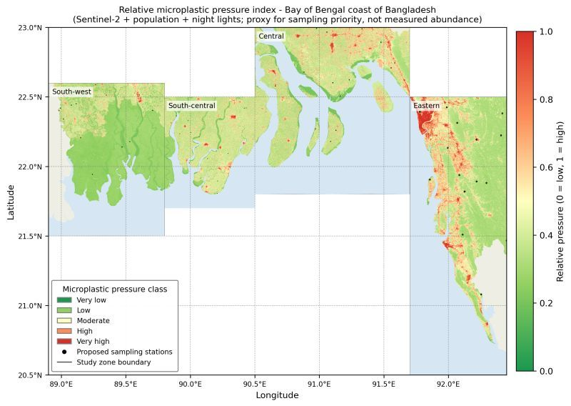</a> <b>Relative microplastic pressure index of Bay of Bengal coast</b></td><td width="33%" valign="top"><a href="figures/fig08.jpg">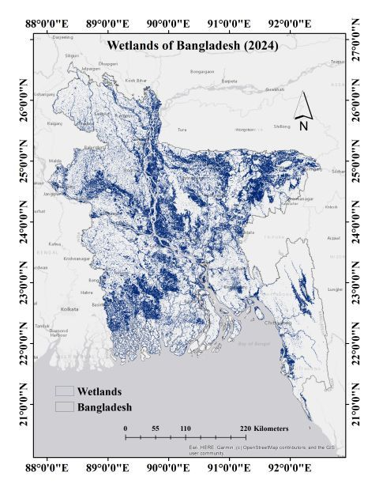</a> <b>Wetlands mapping of Bangladesh (2024)</b></td></tr>
<tr><td width="33%" valign="top"><a href="figures/fig09.jpg">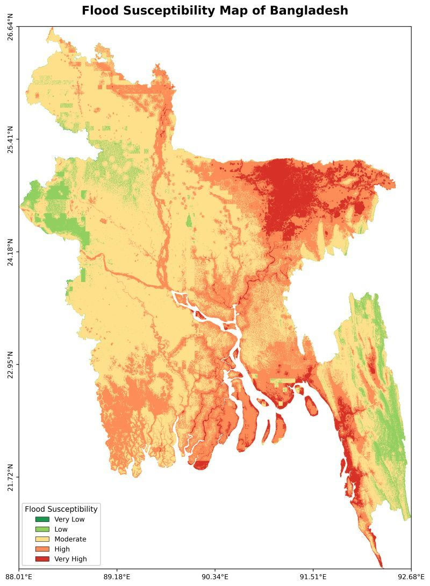</a> <b>Flood susceptibility of Bangladesh</b></td><td width="33%" valign="top"><a href="figures/fig10.jpg">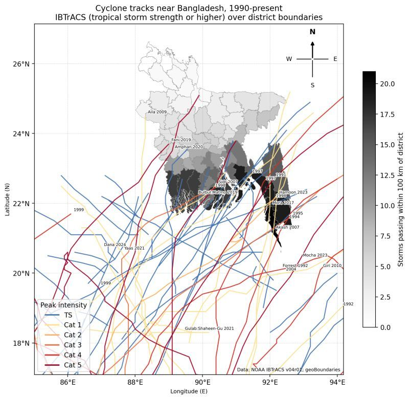</a> <b>Cyclone tracks near Bangladesh (1990–2026)</b></td><td width="33%" valign="top"><a href="figures/fig11.jpg">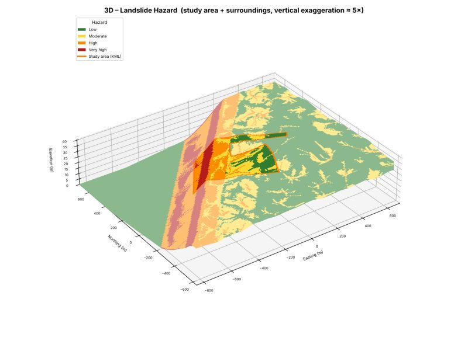</a> <b>3D landslide hazard</b></td></tr>
<tr><td width="33%" valign="top"><a href="figures/fig03.jpg">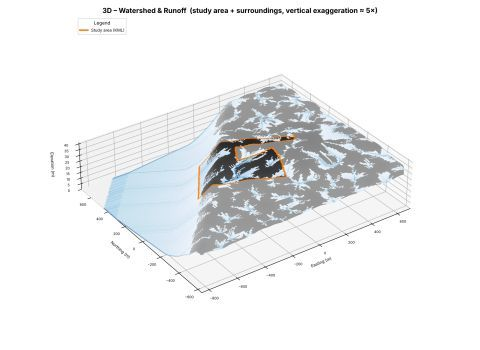</a> <b>3D watershed and runoff surface</b></td><td width="33%" valign="top"><a href="figures/fig12.jpg">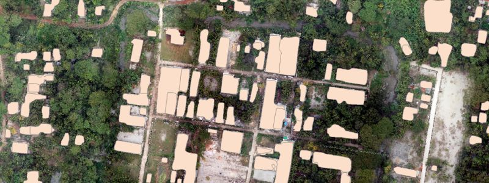</a> <b>Building footprints over aerial imagery</b></td><td width="33%" valign="top"><a href="figures/fig07.jpg">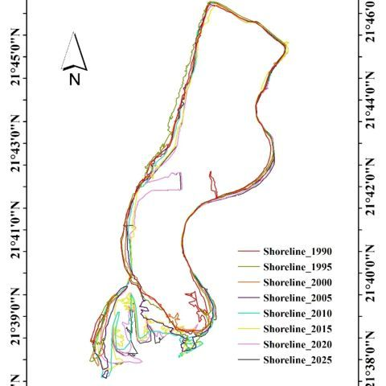</a> <b>Multi-year shoreline overlay (1990–2025)</b></td></tr>
</table>

## 📚 Selected publications

- **Climate change scenario in Bangladesh: historical data analysis and future projection based on CMIP6 model** — *Scientific Reports* 15, 7856 (2025). [doi:10.1038/s41598-024-81250-z](https://doi.org/10.1038/s41598-024-81250-z)
- **Geospatial assessment of urban heat island and LULC dynamics in Khulna City Corporation, Bangladesh** — *Theoretical and Applied Climatology* 157, 237 (2026). [doi:10.1007/s00704-026-06139-5](https://doi.org/10.1007/s00704-026-06139-5)
- **Assessing the Ecological Consequences: Biodiversity Decline in Gopalganj, Bangladesh, under Climate Change** — *Journal of Geoscience and Environment Protection* 11, 297–316 (2023). [doi:10.4236/gep.2023.119019](https://doi.org/10.4236/gep.2023.119019)
- **SHAP-Driven Machine Learning Approaches for LST Modeling Using Surface Indices in Chuadanga** — preprint, Research Square. [doi:10.21203/rs.3.rs-8461364/v1](https://doi.org/10.21203/rs.3.rs-8461364/v1)

## 💼 Experience

- **Research Assistant (full-time)**, Gopalganj Science and Technology University — Dec 2024 – Apr 2026
- **Research Consultant (full-time)**, CEGIS, Remote Sensing Division — May 2024 – Nov 2024
- **Campus Correspondent / Sub-editor**, Protidiner Sangbad & Doinik Astha — Aug 2020 – May 2024
- **Research Assistant (part-time)**, Jahangirnagar University (Mahasthan archaeological survey) — Oct 2020 – Feb 2021

## 🎓 Education

- **MSc, Environmental Science and Disaster Management**, GSTU — Dec 2024 – Oct 2026 (CGPA 3.47/4.00)
- **BSc, Environmental Science and Disaster Management**, GSTU — Jan 2019 – Mar 2024 (CGPA 3.20/4.00)

## 📜 Certifications

Esri (GIS for Climate Action, Going Places with Spatial Analysis, ArcGIS Imagery MOOC, Spatial Data Science, Cartography, GIS Basics, Python for Everyone) · Research Society (GIS and Remote Sensing; Python for Data Analysis) · UNICEF (Emergency Preparedness and Response) · WHO (Standard Precautions: Waste Management, 18 May 2020) · Press Institute of Bangladesh (Investigative Journalism) · Digital Security Agency (Digital Security Essentials)

## 🙌 Volunteering

Environmental Science Club, GSTU (Student Advisor 2024–2026; General Secretary; Research Secretary; PR Secretary) · Disaster Response Team Bangladesh (Founding Member, 2022–present) · GSTU Journalist Forum (Office Secretary)

## 🌱 Currently

- Finishing my MSc thesis: *Evaluation of NEX-GDDP–CMIP6 Multi-Model (29 GCMs): Historical and Future Climate Variability and Extremes in South Asia (1950–2100)*
- Building open, reproducible geospatial workflows in Python and Google Earth Engine

## 🤝 Open to

Research collaborations, geospatial / climate analysis roles, and PhD opportunities in climate, remote sensing and environmental modelling.

---

📍 Bangladesh · 🌐 [ORCID](https://orcid.org/0009-0000-2047-4180)
